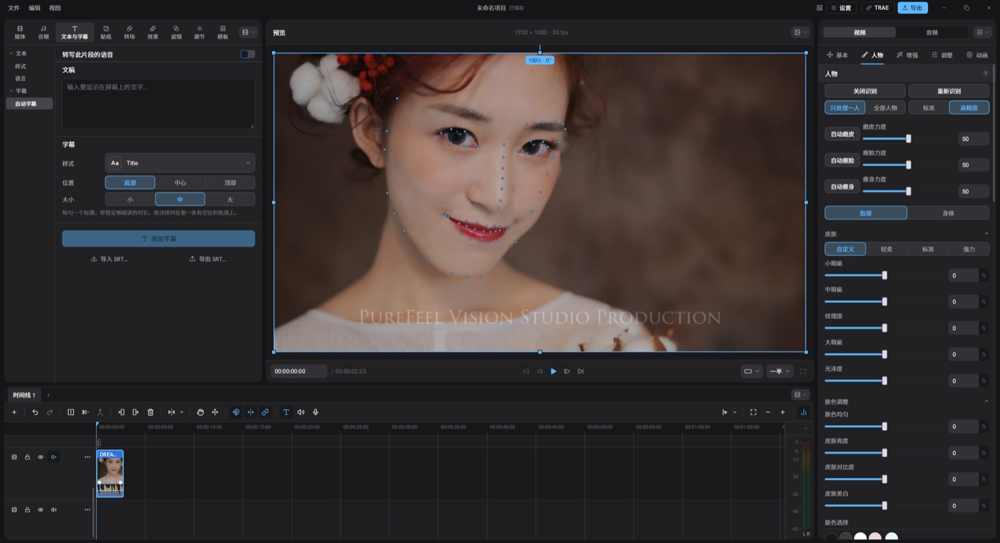
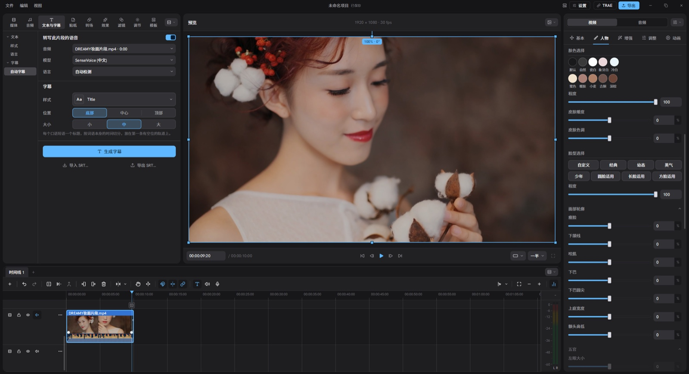
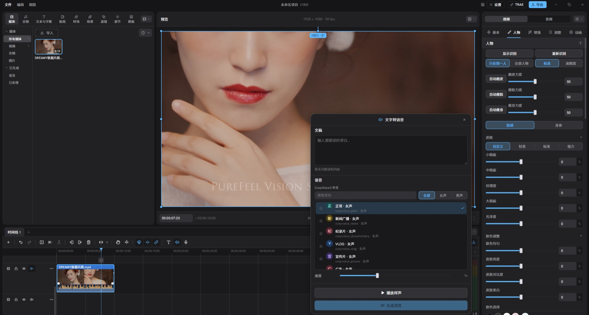

  <a href="README.md">简体中文</a> ·
  <b>English</b>

# DARKFILM

**An intelligent video editor for creators — editing, color grading, subtitles and AI in one window**

*Smart video editing · Color grading · Subtitles · Speech-to-text & text-to-speech — built for creators*

[Report an issue](../../issues)

> **In development**: 0.5.0 has not been released yet and no download is available. The UI and features are still changing; download and install instructions will be added here once it ships.

---

## What is this

DARKFILM is an intelligent video editor for content creators. It folds editing, color grading, subtitles and AI into a single workflow:

- **Subject tracking** — locks onto the subject automatically so effects and layers follow it, with no frame-by-frame keyframing
- **Skin retouch and liquify** — one pass for skin quality, plus fine adjustments to face shape and body
- **Text and speech conversion** — subtitle generation, script-to-voiceover and speech-to-text, so you switch between tools less

The goal is simple: one person, one window, from edit to grade to subtitles to voiceover.

## What's new in 0.5.0

| Update | Description |
| --- | --- |
| **Subject tracking** | Locks onto the subject automatically; effects and layers follow it |
| **Skin retouch and liquify** | Tiered skin retouching plus face-shape adjustments in one pass |
| **Text and subtitles** | One-click subtitle generation, adjustable styling, SRT import and export |
| **Text and speech conversion** | Script to voiceover and speech to text, with multiple built-in voices |

## Screenshots

### Subject tracking and skin retouch

The portrait panel supports "one person only / all faces" and "all / selected" scopes, detects faces automatically and can display facial landmarks so you always know what is being tracked. Retouching offers automatic strength with small / medium / large blemish tiers, and independent controls for texture, gloss, skin-tone evenness, contrast, whitening and skin-tone selection.

### Text and subtitles

The Text & Subtitles panel lets you type your copy, set font, style, position and size, and generate subtitles in one click. Subtitle and recognition languages are selectable, with SRT import and export. The Face section on the right offers refinements for face outline, jawline, masseter, chin, forehead, nose bridge and more.

### Text to speech

Paste a script and turn it into a voiceover. Built-in voices cover regular female, powerful female, documentary male, versatile female, VLOG female, promo male and advertising female, with preview and speed control.

## Key features

### Editing and timeline

- Multi-track timeline with separate video, text/subtitle and audio layers
- Preview window synced with the timeline — drag to seek
- Clips can be repositioned, scaled and trimmed; project media stays in one place

### Color grading

- Basic tonal and color adjustments with real-time preview
- Dedicated skin controls: evenness, contrast, whitening and skin-tone selection

### Subject tracking

- Locks onto the subject automatically; effects and layers follow it
- "One person only / all faces" and "all / selected" scopes
- Facial landmarks can be shown, so tracking and retouching areas are obvious

### Skin retouch and liquify

- Separate auto-retouch, auto face-slimming and auto body-slimming strengths
- Small / medium / large blemish tiers, with texture and gloss controls
- Skin-tone evenness, contrast, whitening and skin-tone selection
- Face refinements: outline, jawline, masseter, chin, forehead, nose bridge

### Text and subtitles

- Type copy in the Text & Subtitles panel; font, style, position and size adjustable
- One-click subtitle generation with selectable subtitle and recognition languages
- SRT import and export

### Text and speech conversion

- Text to speech: multiple voices, preview and speed control
- Speech to text: turn audio into an editable transcript
- Script to voiceover: paste a script and generate the voice track

## Development status

Current version **0.5.0**, in development and not yet released — no installer is available. Version numbers, UI and features are still changing; download and install instructions will be added here once it ships.

## Feedback

Questions or feature requests? Open an [issue](../../issues). Sample footage, system info and reproduction steps help a lot.

## Notes

Independently developed and maintained, part of the same "Dark Flow" family as DARKRAW. The software is provided as-is; please back up your source material — your exported files are the result.
