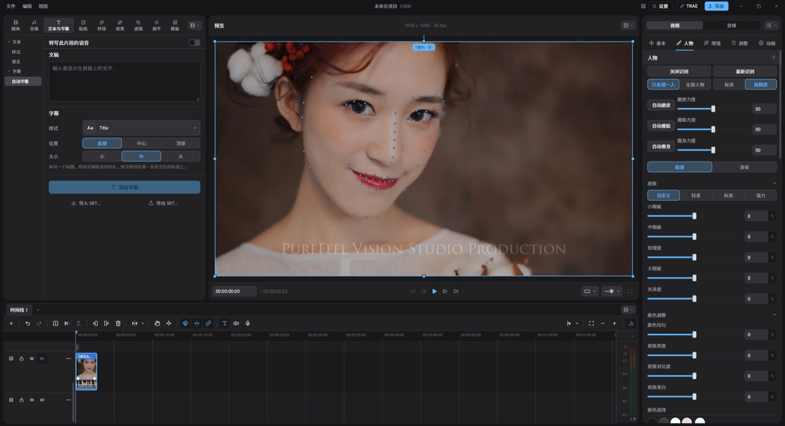
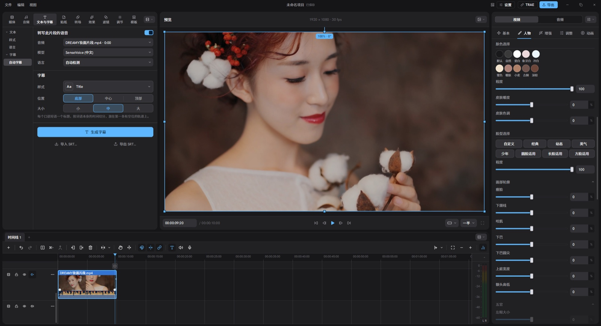
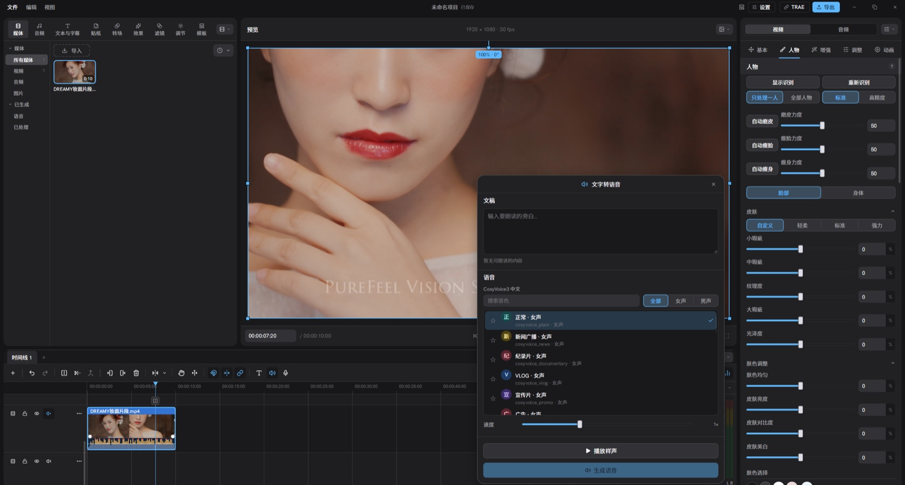

  <b>简体中文</b> ·
  <a href="README.en.md">English</a>

# DARKFILM | 暗流快剪

**面向内容创作者的智能视频剪辑软件：剪辑、调色、字幕与 AI，收进同一个窗口**

*Smart video editing · Color grading · Subtitles · Speech-to-text & text-to-speech — built for creators*

[问题反馈](../../issues)

> **开发中**：0.5.0 尚未发布，暂不提供下载。界面与功能仍在迭代，正式上线后会在此页更新。

---

## 这是什么

DARKFILM（暗流快剪）是一款面向内容创作者的智能视频剪辑软件，把剪辑、调色、字幕与 AI 能力放进同一个工作流：

- **人物跟踪**：自动锁定画面主体，特效与图层贴身跟随，不再逐帧手动打关键帧
- **磨皮与液化**：一键完成肤质优化，并对脸型、身形做微调
- **文字语音互转**：字幕生成、文稿转配音、语音转文字，少在几个工具之间来回切换

目标很简单：一个人、一个窗口，把一条片子的剪辑、调色、字幕和配音做完。

## 0.5.0 更新亮点

| 更新 | 说明 |
| --- | --- |
| **人物跟踪** | 自动锁定人物主体，特效与图层可跟随主体移动 |
| **磨皮与液化** | 分级磨皮配合脸型微调，肤质与轮廓一次处理 |
| **文字与字幕** | 字幕一键生成，样式可调，支持 SRT 导入导出 |
| **文字语音互转** | 文稿转配音、语音转文字，内置多种音色 |

## 界面预览

### 人物跟踪与磨皮

人像面板支持「只要一人 / 全部人脸」与「全部 / 指定」切换，可自动识别并显示人脸关键点，便于确认跟踪与修饰范围。磨皮提供自动强度与大中小瑕疵分级，纹理度、光泽度、肤色均匀度、肤色对比度、肤色美白与肤色选择均可单独调节。

### 文字与字幕

「文字与字幕」面板可输入文案，设置字体、样式、位置与大小，一键生成字幕；字幕语言与识别语言可选，并支持导入、导出 SRT。右侧「人物 → 脸型」提供脸型轮廓、下颚线、咬肌、下巴缩短、额头高低、鼻梁等微调项。

### 文字转语音

输入文稿即可转成配音，内置正规女声、霸气女声、纪录片男声、百变女声、VLOG 女声、宣传片男声、广告女声等音色，支持试听与语速调节。

## 主要功能

### 剪辑与时间线

- 多轨时间线，视频、文字/字幕与音频分层编排
- 预览窗口与时间线联动，拖动即可定位
- 片段可调整位置、缩放与时长，工程内素材统一管理

### 调色

- 基础影调与色彩调整，实时预览
- 人物肤色独立处理：肤色均匀度、对比度、美白与肤色选择

### 人物跟踪

- 自动锁定人物主体，特效与图层跟随主体移动
- 「只要一人 / 全部人脸」「全部 / 指定」范围可选
- 人脸关键点可显示，跟踪与修饰范围一目了然

### 磨皮与液化

- 自动磨皮、自动瘦脸、自动修身强度可分别调节
- 小瑕疵 / 中瑕疵 / 大瑕疵分级磨皮，纹理度与光泽度可调
- 肤色均匀度、对比度、美白与肤色选择
- 脸型微调：脸型轮廓、下颚线、咬肌、下巴、额头、鼻梁等

### 文字与字幕

- 文字与字幕面板：文案输入，字体、样式、位置、大小可设
- 一键生成字幕，字幕语言与识别语言可选
- 支持导入、导出 SRT

### 文字语音互转

- 文字转语音：多种音色可选，支持试听与语速调节
- 语音转文字：把音频转成可编辑文稿
- 文稿转配音：输入文稿直接生成配音

## 开发状态

当前版本 **0.5.0**，处于开发中，尚未上线，暂不提供安装包。版本号、界面与功能仍在调整，正式发布后会在这里补充下载方式与安装说明。

## 反馈

使用中遇到问题或有功能建议，欢迎提交 [Issue](../../issues)。如果能附上样片、系统信息与操作步骤，定位会快很多。

## 说明

本项目为个人独立开发与维护，与 DARKRAW 同属「暗流」系列。软件按现状提供，请自行备份原始素材；处理结果以你自己导出保存的文件为准。
